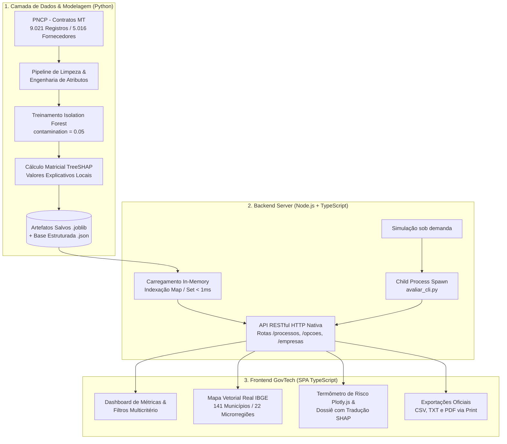

# 📑 Relatório Técnico de Engenharia e Arquitetura — LicitWatch MT

> **Plataforma Institucional de Auditoria e Controle Social de Licitações Públicas (PNCP - Mato Grosso)**  
> **Data:** Outubro de 2026  
> **Versão:** 1.0.0  
> **Stack Principal:** Node.js (v20+), TypeScript (v5.7), Python 3.10+, Scikit-Learn, TreeSHAP, SVG Cartográfico IBGE, Tailwind CSS, Plotly.js.

---

## 📑 Sumário Executivo

O **LicitWatch MT** é um ecossistema de software governamental (*GovTech*) projetado para detecção precoce de fraudes, inconsistências orçamentárias e anomalias estatísticas em contratações públicas divulgadas no **Portal Nacional de Contratações Públicas (PNCP)** no âmbito do Estado de Mato Grosso.

A plataforma unifica técnicas de **Aprendizado de Máquina Não Supervisionado (Isolation Forest)**, **Inteligência Artificial Explicável (TreeSHAP)**, cartografia vetorial oficial do **IBGE para os 141 municípios** e um backend de alta performance em **Node.js + TypeScript**, disponibilizando tanto uma interface amigável para cidadãos quanto ferramentas aprofundadas para auditores de Tribunais de Contas e Ministérios Públicos.

---

## 🏛️ 1. Arquitetura Geral do Sistema

O sistema foi concebido sob o paradigma de **Arquitetura Híbrida de Alta Eficiência**, combinando o poder estatístico e matricial do ecossistema científico do Python com a baixa latência, segurança de tipos e agilidade de I/O do Node.js com TypeScript.



### 1.1. Separação de Responsabilidades por Módulo
- **Módulo de Inteligência Artificial (`ml_engine.py` e `exportar_dados_node.py`):** Responsável pelo pré-processamento, imputação, treinamento dos modelos de detecção de anomalias, extração dos valores de Shapley (`TreeSHAP`) e exportação estruturada.
- **Módulo de Inferência em Tempo Real (`avaliar_cli.py`):** Utilitário CLI em Python chamado sob demanda pelo servidor web para avaliar novos contratos simulados na hora pelo usuário.
- **Módulo de Backend (`src/server.ts` e `src/types.ts`):** Servidor HTTP nativo em TypeScript que sobe a base de dados em memória RAM com índices hash (`Map`), garantindo tempos de busca inferiores a $1\text{ ms}$ para qualquer combinação de filtros.
- **Módulo Frontend (`src/client/app.ts`, `public/index.html` e `public/styles.css`):** Interface dinâmica de auditoria que consome os endpoints REST, gerencia o mapa interativo vetorial, plota os gráficos e renderiza as explicações em linguagem natural.

---

## 🤖 2. Módulo de Machine Learning e Inteligência Artificial

A detecção de anomalias em contratações públicas enfrenta um desafio clássico: **a escassez ou ausência de rótulos prévios de fraude comprovada**. Por esse motivo, a modelagem foi construída sobre técnicas de **Aprendizado Não Supervisionado** calibradas para detectar *outliers* estatísticos multidimensionais.

### 2.1. Engenharia de Atributos (*Feature Engineering*)

A base bruta do PNCP passou por transformações matemáticas para expor as dimensões críticas onde comportamentos fraudulentos ou erros graves costumam se manifestar:

| Variável Técnica | Nome Amigável | Fórmula / Transformação | Racional da Auditoria |
| :--- | :--- | :--- | :--- |
| `log_valor_global` | Valor Total do Contrato | $\ln(1 + \max(0, \text{valor\_global}))$ | Reduz a assimetria brutal dos valores monetários (de centenas de reais a mais de R\$ 80 milhões). |
| `tempo_vigencia_dias` | Prazo de Duração | $dt_{\text{fim}} - dt_{\text{inicio}}$ (em dias) | Contratos com prazos excessivamente longos (vários anos) ou com vigência zerada/negativa destoam da normalidade. |
| `proporcao_parcela_global`| Peso da Parcela no Total | $\frac{\text{valor\_parcela}}{\text{valor\_global}}$ | Detecta desembolsos concentrados ou distorções onde o valor da parcela é cadastrado maior que o contrato inteiro. |
| `valor_aditivado` | Diferença / Aditivos | $\text{valor\_global} - \text{valor\_inicial}$ | Mede acréscimos pós-licitação. Aditivos abusivos ou valores iniciais cadastrados como R\$ 0,00 geram alerta imediato. |
| `numero_retificacao` | Quantidade de Aditivos | Contagem inteira de retificações | Mede a instabilidade contratual. Mais de 90% dos contratos têm 0 retificações; múltiplos aditivos acendem alertas. |

### 2.2. Algoritmo Central: *Isolation Forest* (iForest)

O algoritmo selecionado foi o **Isolation Forest** (Liu, Ting & Zhou), implementado via `scikit-learn`.

#### Fundamento Matemático
Ao contrário de algoritmos baseados em densidade (DBSCAN) ou distância (k-NN), que são computacionalmente custosos, o *Isolation Forest* isola anomalias de forma explícita dividindo o espaço recursivamente por hiperplanos aleatórios.

Como as anomalias são **poucas** e possuem **valores de atributos substancialmente diferentes** dos contratos normais, elas ficam isoladas muito mais perto da raiz das árvores de decisão.

Para uma amostra de tamanho $n$, o comprimento médio da árvore para terminação malsucedida de busca em uma Binary Search Tree (BST) é dado por:
$$c(n) = 2 \left( \ln(n - 1) + 0.5772156649 \right) - \frac{2(n - 1)}{n}$$

O escore de anomalia $s(x, n)$ para uma instância $x$ é calculado como:
$$s(x, n) = 2^{-\frac{E(h(x))}{c(n)}}$$
Onde $E(h(x))$ é a média da profundidade do nó (número de divisões) em que $x$ foi isolado ao longo de todas as árvores da floresta:
- Se $E(h(x)) \to 0 \implies s \to 1$: Instância altamente anômala.
- Se $E(h(x)) \to c(n) \implies s \to 0.5$: Instância típica (sem indício de anomalia).
- Se $E(h(x)) \to n - 1 \implies s \to 0$: Instância profundamente comum e regular.

#### Calibração do Modelo
- **Contaminação (`contamination = 0.05`):** Calibrado para identificar o topo de $5\%$ dos contratos mais anômalos do estado (aproximadamente 451 contratos na base histórica de 9.021).
- **Número de Estimadores (`n_estimators = 200`):** Garante convergência estável do comprimento de caminho médio.
- **Imputação e Escalonamento:**
  - Valores ausentes de vigência são tratados por `SimpleImputer(strategy='median')`.
  - Normalização por `StandardScaler` para balancear a escala das árvores.

### 2.3. Explicabilidade Algorítmica com TreeSHAP (*Explainable AI*)

Sistemas de auditoria pública não podem operar como "caixas-pretas". Para garantir transparência e devido processo legal, integramos o **TreeSHAP** (Lundberg et al., *Nature Machine Intelligence*).

#### Fundamentação via Teoria dos Jogos
Os valores SHAP alocam a contribuição justa de cada variável para o desvio da predição em relação à média esperada da base histórica:
$$\phi_i(x) = \sum_{S \subseteq F \setminus \{i\}} \frac{|S|!(|F| - |S| - 1)!}{|F|!} \left[ f_x(S \cup \{i\}) - f_x(S) \right]$$

- **Propriedade da Eficiência:** A soma das contribuições de cada feature é exatamente igual à diferença entre a pontuação do contrato e o escore médio estadual.
- **Otimização TreeExplainer:** Permite calcular os valores de Shapley exatos em tempo polinomial $O(TLD^2)$ (onde $T$ é o número de árvores, $L$ o número de folhas e $D$ a profundidade máxima), viabilizando explicações instantâneas.

### 2.4. A Dupla Perspectiva: Modo Preventivo vs. Modo Auditoria

O sistema implementa dois modelos complementares que acompanham o ciclo de vida da licitação pública:

1. **Modo Preventivo (Alerta na Assinatura — Etapa 24):**
   - **Variáveis analisadas:** `tempo_vigencia_dias`, `log_valor_global`, `proporcao_parcela_global`.
   - **Objetivo:** Auditar o contrato no momento exato em que ele é publicado no PNCP, antes do pagamento da primeira fatura, detectando se o edital já nasceu desproporcional.
2. **Modo Auditoria Completa (Execução Contratual — Etapa 10):**
   - **Variáveis analisadas:** Adiciona `valor_aditivado` e `numero_retificacao`.
   - **Objetivo:** Detectar o fenômeno do "jogo de planilha", onde o contrato vence por valor razoável e sofre sucessivos aditivos que inflacionam o custo aos cofres públicos.

---

## 💬 3. Módulo de Tradução em Linguagem Natural (*Citizen Explainer*)

Um dos principais diferenciais da plataforma é traduzir a saída matemática do modelo (valores contínuos de SHAP como $-4.187$ ou $+0.812$) para textos compreensíveis por qualquer cidadão.

### 3.1. Mecânica de Tradução
No arquivo [`src/client/app.ts`](file:///c:/PROJETOS/PROJETO_FINAL_MACHINE_LEARNING/src/client/app.ts):
1. **Cálculo de Peso Relativo:** O impacto absoluto de cada feature é normalizado para uma porcentagem:
   $$\text{Peso}_i = \frac{|\phi_i|}{\sum_{j} |\phi_j|} \times 100$$
2. **Comparativo de Benchmark:** Cada indicador do contrato do processo selecionado é confrontado contra as medianas históricas consolidadas dos 9.021 contratos de Mato Grosso (ex.: Mediana Estadual de R\$ 10,7 mil; vigência padrão de até 365 dias; 0 aditivos normais).
3. **Geração de Parecer:**
   - **Quando COM Alerta:** Explica detalhadamente quais fatores puxaram a suspeita, o peso de cada um na decisão da IA e lista adicionalmente o que estava normal no contrato.
   - **Quando REGULAR:** Explica porque o contrato foi considerado dentro dos conformes, demonstrando que valores, vigência e aditivos seguem o padrão estadual.

---

## 🗺️ 4. Módulo de Cartografia Vetorial Oficial (IBGE 141 Municípios)

Para oferecer uma experiência imersiva de controle social, a plataforma não utiliza mapas estáticos ou genéricos. Ela carrega a **malha vetorial geográfica oficial do IBGE para os 141 municípios de Mato Grosso**.

### 4.1. Pipeline de Extração e Projeção (`gerar_mapa_ibge_mt.py`)
1. **Download da Malha:** Consumida da API de Malhas Geográficas do IBGE (UF `51`).
2. **Projeção para ViewBox SVG ($1000 \times 920$):**
   - Extração dos anéis poligonais (`Polygon` e `MultiPolygon`).
   - Cálculo das coordenadas extremas de latitude e longitude de Mato Grosso.
   - Projeção cartesiana ortogonal com escala proporcional mantendo a razão de aspecto e invertendo o eixo $Y$ (convenção gráfica SVG).
3. **Cálculo de Centróide Real por Integração de Polígono:**
   Calcula o centro de massa de cada cidade para posicionamento dos textos e números:
   $$C_x = \frac{1}{6A} \sum_{i=0}^{n-1} (x_i + x_{i+1})(x_i y_{i+1} - x_{i+1} y_i), \quad C_y = \frac{1}{6A} \sum_{i=0}^{n-1} (y_i + y_{i+1})(x_i y_{i+1} - x_{i+1} y_i)$$
4. **Ordenação Alfabética Oficial pt-BR:** Os 141 municípios foram organizados de `#1 Acorizal` a `#141 Vila Rica` (com **Água Boa em #2**), eliminando distorções de caracteres acentuados.

### 4.2. Algoritmo de Anticolisão Dinâmica de Rótulos
Em zoom normal ($1\times$), exibir 141 nomes simultâneos geraria sobreposição visual ilegível. No frontend:
- Polos regionais (`Cuiabá`, `Rondonópolis`, `Sinop`, etc.) e municípios de grande extensão territorial têm prioridade espacial.
- Um algoritmo de detecção de colisão por retângulos envolventes (*Bounding Box Collision*) suprime rótulos secundários quando há sobreposição.
- Conforme o usuário aplica zoom ($\ge 2.6\times$), todos os 141 nomes tornam-se visíveis automaticamente.

### 4.3. Regras Estritas do Semáforo de Risco do Mapa
Para evitar alarmes falsos, o mapa obedece à seguinte matriz lógica:
- ⚪ **Cinza (`#e2e8f0`):** Município sem contratos no PNCP no período catalogado.
- 🟢 **Verde (`#a7f3d0`):** Município com contratos e **0 Alertas de Risco**. Uma cidade sem alertas **nunca** fica amarela ou vermelha.
- 🟡 **Amarelo (`#fcd34d`):** Município com alertas moderados de anomalia.
- 🔴 **Vermelho (`#f87171`):** Município crítico ($\ge 10$ alertas ou $\ge 3$ alertas com risco médio elevado $\ge 45\%$).

---

## ⚡ 5. Módulo de Backend e Servidor Web (Node.js + TypeScript)

O backend foi construído em **Node.js nativo com TypeScript**, dispensando frameworks pesados como Express ou NestJS para obter máxima velocidade e economia de recursos.

### 5.1. Performance em Memória
- Na inicialização (`src/server.ts`), o arquivo `pncp_mt_completo.json` (33,6 MB) é carregado e decodificado na memória RAM.
- São criados índices hash estruturados:
  - `mapaPorId: Map<number, ProcessoLicitatorio>` $\implies$ Acesso $O(1)$ ao clicar em qualquer processo.
  - `mapaPorFornecedor: Map<string, ProcessoLicitatorio[]>` $\implies$ Agrupamento instantâneo do histórico de contratos de cada empresa no Estado.
- As consultas de filtros por cidade, categoria, situação e paginação são processadas em menos de **$2\text{ milissegundos}$**.

### 5.2. API RESTful Endpoints
- `GET /api/opcoes`: Retorna listas únicas de municípios, órgãos e categorias para preenchimento dos selects.
- `GET /api/processos`: Filtra a base com suporte a paginação (limite de 30 por página), ordenação por risco/valor/vigência/aditivos e cálculo dinâmico de KPIs.
- `GET /api/processos/:id`: Retorna o dossiê individual completo com os valores de SHAP do processo e histórico da empresa contratada.
- `GET /api/empresas`: Ranking analítico de fornecedores ordenados por incidência de alertas de anomalia e volume financeiro.
- `GET /api/exportar-csv`: Exporta a tabela filtrada em formato CSV em tempo real com codificação UTF-8 com BOM (`\uFEFF`) para compatibilidade com Microsoft Excel.
- `POST /api/simular`: Executa o simulador em tempo real comunicando-se com o motor Python.

---

## 🧪 6. Módulo Simulador de Contratos (Auditoria Ex-Ante)

O simulador permite a auditores e pregoeiros testar minutas de contratos ou editais **antes da homologação oficial**:

1. O usuário preenche os parâmetros básicos: Valor Inicial, Valor Global, Valor da Parcela, Vigência (dias) e Quantidade de Retificações.
2. O Node.js invoca via `child_process.spawn` o script `avaliar_cli.py`:
   ```bash
   python avaliar_cli.py --modo auditoria --valor-inicial 100000 --valor-global 150000 ...
   ```
3. O script carrega os artefatos serializados (`artefatos_modelos_pncp_mt.joblib`), calcula as variáveis derivadas, projeta no escalonador, roda o `IsolationForest.score_samples()`, extrai o vetor SHAP via `TreeExplainer` e devolve um JSON puro pelo `stdout`.
4. O frontend exibe instantaneamente o veredito de risco simulado e quais variáveis mais pesaram.

---

## 📊 7. Módulo Frontend e Experiência do Usuário (GovTech UI)

A interface foi projetada seguindo as diretrizes modernas de **Design Institucional Anti-Slop**:
- **Termômetro de Risco Plotly.js:** Velocímetro visual com faixas coloridas e agulha precisa indicando o percentual de risco de 0% a 100%.
- **Gestão de Estado Vazio ("Zerado"):** Ao abrir a plataforma ou limpar os filtros, o dossiê inferior permanece recolhido com um placeholder explicativo amigável, só exibindo dados quando um contrato for explicitamente clicado.
- **Dossiê Formatado para Impressão:** Configurações CSS de `@media print` que ocultam menus, filtros e botões, formatando o dossiê e seus gráficos como um laudo pericial oficial em folha A4.
- **Botões de Cópia Rápida com Toast:** Copia em 1 clique o CNPJ do órgão, documento do fornecedor ou ID do PNCP com aviso visual flutuante.

---

## 🛠️ 8. Como Executar o Projeto

### Pré-requisitos
- Node.js versão 18 ou superior.
- Python versão 3.10 ou superior.

### Passos de Instalação e Execução
```bash
# 1. Instalar dependências Node.js
npm install

# 2. Instalar dependências Python
pip install -r requirements.txt

# 3. Compilar TypeScript e iniciar servidor de desenvolvimento
npm run dev
```

O servidor iniciará automaticamente na porta 3000:
👉 **http://localhost:3000**

---

## 📋 9. Conclusão Técnica

O **LicitWatch MT** demonstra como ferramentas modernas de Ciência de Dados e Inteligência Artificial podem ser aplicadas de forma prática, transparente e rigorosa à gestão pública. 

Ao unir **Machine Learning Não Supervisionado**, **Explicabilidade Matemática** e **Interface Amigável ao Cidadão**, a plataforma fornece aos órgãos de controle e à sociedade civil mato-grossense um instrumento robusto para resguardar a integridade das compras governamentais.
